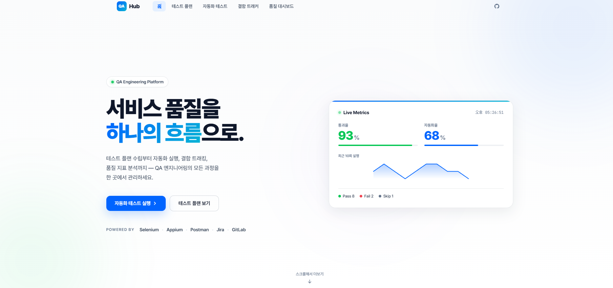

# QA Hub

> QA 엔지니어링의 전 과정을 하나의 콘솔로 — **테스트 플랜 → AI TC 생성 → 자동화 실행 → API 테스트 → CI/CD → 결함 추적**

**Live Demo** · [qa-dashboard-flax.vercel.app](https://qa-dashboard-flax.vercel.app)
**Source** · [GitHub](https://github.com/subeen-park/qa-dashboard)



---

## 왜 만들었나

QA 업무는 여러 도구에 흩어져 있습니다. 테스트 플랜은 스프레드시트, 자동화는 별도 리포, API 테스트는 Postman, 결함 추적은 Jira, 결과 집계는 수동.

**모든 흐름을 하나의 콘솔로 통합하고, AI로 반복 업무를 자동화하면 QA 엔지니어가 설계·분석·전략에 집중할 수 있다** — 가 출발점.

---

## 메뉴 구성

### 1. 홈
서비스 포지셔닝 + 자동화 하이라이트 메트릭.

### 2. 테스트 플랜 (WBS)
프로젝트별 Work Breakdown Structure로 TC 설계·담당자 배정·진행률 추적.
- 좌측 사이드바에 **Releases 버전별 필터** (GitHub Releases 느낌)
- 프로젝트 CRUD, Task CRUD
- 지연 플래그 자동 표시

### 3. 자동화 테스트 ⭐
**실제로 돌아가는 Playwright 자동화 엔진.**

- TC는 DB(`testcases` 테이블)에 저장, UI에서 CRUD
- Run 버튼 → Flask 백엔드가 **백그라운드 스레드**로 Chromium 실행 → saucedemo.com 조작
- **500ms 스크린샷 폴링**으로 실행 중인 테스트 실시간 모니터링
- 각 스텝별 통과/실패 상태 + 실행 시간 + 자동 한글 설명
- 실행 결과는 `test_runs` 테이블에 영구 저장

**샘플 TC 5개**:

| TC | 시나리오 | Level | Domain | 예상 |
|----|---------|-------|--------|------|
| TC-001 | 로그인 성공 (유효한 자격증명) | Smoke | 로그인 | Pass |
| TC-002 | 로그인 실패 (잠긴 계정 에러 검증) | Smoke | 로그인 | Pass |
| TC-003 | 장바구니 상품 추가 — 뱃지 반영 | Regression | 장바구니 | Pass |
| TC-004 | 결제 완료 End-to-End (14스텝) | E2E | 결제 | Pass |
| TC-005 | 이미지 깨짐 검증 (problem_user) | Regression | 이미지 | **의도된 Fail** |

**TC-005 포트폴리오 하이라이트** — saucedemo의 `problem_user` 계정은 **의도적으로 상품 이미지가 깨지도록 설계된 계정**. 자동화가 `[data-test="inventory-item"] img`의 `src` 속성에 `sl-404` 포함을 검증해 결함을 정확히 검출.

> **"자동화 TC의 목표는 통과율이 아니라 결함 검출"** 을 증명하는 사례. 통과한 자동화 ≠ 품질 보장.

### 4. AI TC 생성 (자동화 메뉴 내 통합) ⭐
자연어 설명 → Playwright TC JSON → DB 저장 → 즉시 실행.

- **Gemini 2.0 Flash API** 연동 (Google AI Studio 무료 티어)
- Provider 추상화 (키 없으면 Demo Mode 폴백 → 공개 저장소에서도 작동)
- 생성된 TC는 **`✦ AI` 뱃지**로 시각적 식별
- 모달에서 **Level + Domain** 두 축 분류 입력
- 자연어 → 구조화된 자동화 TC가 되기까지의 E2E 파이프라인

```
사용자 입력                    Gemini API              DB + 자동화 엔진
──────────                   ──────────              ─────────────────
"로그인 성공 검증"    ───>   JSON TC 생성   ───>    testcases 저장
URL: saucedemo.com                                   → Run 클릭 → Playwright 실행
Level: Smoke                                         → 500ms 폴링 스크린샷
Domain: 로그인                                       → test_runs 저장
```

### 5. API 테스트 (Phase 2, 예정)
- Postman Collection v2.1 JSON 업로드 → 순차 실행 → 결과 테이블
- 상태 코드·응답 시간·바디 Assertion
- Swagger OpenAPI 스펙 기반 자동 테스트 추가 예정

### 6. CI/CD 파이프라인 (Phase 3, 예정)
- GitHub Actions 실연동 (`.github/workflows/qa-automation.yml`)
- 머지 시 자동화 TC 자동 실행 → 결과 리포트
- 현재는 Demo 뱃지 상태 → 실 연동으로 승격 예정

### 7. 디바이스팜 / 결함 트래커
설계 완료, 데모 데이터 시연 중. 별도 프로젝트 [Mini Device Farm](../mini-device-farm) 에서 Android 실기기 디바이스팜 PoC 구축.

---

## TC 분류 체계 — 2단 모델

업계 표준 테스트 피라미드(Level)와 비즈니스 도메인(Domain)을 **두 축으로 분리**해서 TC를 분류.

**Level (테스트 티어)**
- **Smoke** — 핵심 플로우 빠른 확인 (릴리즈 전 필수)
- **Regression** — 기존 기능 깨짐 없는지 전체 점검
- **E2E** — 사용자 시나리오 끝에서 끝까지

**Domain (대상 영역)**
- 로그인 / 결제 / 장바구니 / 이미지 / 알림 / 검색 / 등

한 TC가 두 축으로 분류됨 → 예: `결제 완료 E2E` = Level `E2E`, Domain `결제`.
상단 Level 탭 필터로 테스트 티어별 그룹 뷰 전환.

---

## 기술 스택

| 영역 | 기술 |
|------|------|
| Frontend | Vue 3 (Options API), Vite, Pretendard Variable |
| Backend | Flask (Python 3.11), psycopg2, python-dotenv |
| Database | PostgreSQL (Supabase, Tokyo region) |
| 자동화 엔진 | Playwright (Chromium) |
| AI | Gemini 2.0 Flash (google-generativeai) |
| 배포 | Vercel (Frontend), Render (Backend Web Service) |
| 모니터링 | UptimeRobot (keep-alive, cold start 제거) |

---

## 아키텍처 (자동화 테스트 + AI 통합)

```
┌─────────────────────────────┐
│  Frontend (Vue 3)            │
│  - 자동화 테스트 콘솔          │
│  - AI 생성 모달               │
│  - Level/Domain 필터          │
└──────────────┬──────────────┘
               │ REST
┌──────────────▼──────────────┐
│  Backend (Flask)            │
│  ├─ /api/testcases          │  TC CRUD
│  ├─ /api/ai/generate-tc     │  자연어 → TC 생성
│  ├─ /api/ai/health          │  Gemini / Demo 상태
│  ├─ /api/testcases/:id/run  │  자동화 백그라운드 실행
│  └─ /api/test-runs/:id      │  결과 조회
└──────────────┬──────────────┘
         ┌─────┴──────┐
         │            │
┌────────▼────┐  ┌───▼──────────┐
│ Playwright  │  │ Gemini API   │
│ (Chromium)  │  │ (2.0 Flash)  │
└─────┬───────┘  └──────────────┘
      │
      ▼
┌─────────────┐
│ PostgreSQL  │  testcases + test_runs + projects + tasks
│ (Supabase)  │
└─────────────┘
```

### 설계 포인트

**1. AI Provider 추상화 (키 없이도 작동)**
- `GEMINI_API_KEY` 있으면 실제 Gemini 호출
- 없으면 자동으로 Demo Mode 폴백 (키워드 매칭 샘플 응답)
- 공개 저장소 fork 한 사람도 바로 실행 가능

**2. 백그라운드 자동화 실행**
- Run 요청은 즉시 `run_id` 반환, Playwright는 백그라운드 스레드
- 창을 닫고 다른 TC도 실행 가능 → 멀티태스킹 UX

**3. TC는 DB(JSONB)에 저장**
- 파일 1개당 TC 1개 구조는 200 TC = 200 파일 → 운영 불가능
- `steps` JSONB 저장 → UI에서 CRUD, 스케일 걱정 없음

**4. 2단 분류 체계**
- Level × Domain으로 분류해 테스트 전략 관점(피라미드)과 운영 관점(도메인) 둘 다 커버

---

## 로컬 실행

**백엔드**
```bash
cd backend
pip install -r requirements.txt
playwright install chromium
cp .env.example .env         # DATABASE_URL + GEMINI_API_KEY (선택) 입력
python migrate.py            # 테이블 생성
python migrate_add_level.py  # Level 컬럼 추가 + 기존 TC 재매핑
python seed_testcases.py     # Seed TC 5개
python seed_projects.py      # Seed 프로젝트 5개
python app.py
```

**프론트엔드**
```bash
cd frontend
npm install
npm run dev
```

**CLI로 TC 직접 실행** (디버깅용)
```bash
cd backend
python -m automation TC-001 --headed    # 실제 창 띄우며 실행
python -m automation TC-005 --headed    # 이미지 깨짐 결함 검출 재현
```

**Gemini API 키 발급** (선택, 없으면 Demo Mode)
1. https://aistudio.google.com/apikey
2. Create API key
3. `.env`에 `GEMINI_API_KEY=발급받은_키` 추가

---

## 환경별 라이브 뷰 전략

| 환경 | 라이브 뷰 방식 | 이유 |
|------|-------------|------|
| **공개 데모** (Vercel + Render Free) | Playwright 실행 + 500ms 스크린샷 폴링 | 서버 자원 보호 + 라이브 느낌 유지 |
| **로컬 개발** | Playwright `headless=False`로 실제 창 | 디버깅 편의 |
| **사내 확장** | Xvfb + noVNC로 서버 Chromium 화면 공유 | 보안 제약 없음, QA 팀 전체 공유 가능 |

**Render Free (512MB RAM) 최적화**
- Chromium 런칭 플래그 20개+ (메모리/CPU 절약)
- Viewport 1024x576 축소
- `slow_mo` 50ms로 라이브 뷰 가독성 vs 속도 균형
- UptimeRobot 5분 ping으로 cold start 제거

---

## 포트폴리오 하이라이트

### 1. 실제 돌아가는 자동화 (데모 아님)
Playwright가 saucedemo.com을 실시간 조작. TC-005로 **의도된 결함 검출** 사례까지 포함.

### 2. AI Native 설계
자연어 → 구조화된 자동화 TC → 즉시 실행 E2E 파이프라인.
Gemini API 뿐 아니라 **Provider 교체 가능한 추상 레이어**로 확장성 확보.

### 3. 2단 분류 체계로 QA 전략 모델링
테스트 피라미드(Level) × 비즈니스 도메인(Domain)으로 TC를 분류.
단순 CRUD가 아닌 **QA 테스트 전략 설계** 관점 반영.

### 4. TC 라이프사이클 완전 통합
생성(AI/수동) → 조회(Level 필터) → 수정 → 삭제 → 실행 → 결과 저장 → 리포트가 **하나의 콘솔**에서 완결.

### 5. "통과율 ≠ 품질" 관점
TC-005로 자동화의 본질이 결함 검출임을 증명하는 사례를 코드로 구현.

---

## 한계 및 다음 단계

**현재 한계**
- 단일 호스트 / 단일 브라우저 (Chromium만)
- 모바일 테스트는 별도 프로젝트([Mini Device Farm](../mini-device-farm))에서 커버
- API 테스트 메뉴 설계 완료, 구현 예정
- CI/CD 실연동 설계 완료, GitHub Actions 연결 예정

**다음 단계**
- Phase 2: Postman Collection v2.1 기반 API 테스트 메뉴
- Phase 3: GitHub Actions 실연동 (현재 Demo → LIVE 뱃지 승격)
- 결함 트래커 Jira REST API 실연동 (현재 모의 데이터)
- AI 기능 확장: "실패한 TC의 원인 분석" / "스펙 문서 → TC 세트 자동 생성"

---

## 프로젝트 구조

```
qa-dashboard/
├─ backend/
│  ├─ app.py                    # Flask 진입점
│  ├─ db.py                     # DB 커넥션
│  ├─ migrate.py                # 테이블 생성
│  ├─ migrate_add_level.py      # Level 컬럼 추가
│  ├─ seed_testcases.py         # Seed TC 5개
│  ├─ seed_projects.py          # Seed 프로젝트 5개
│  ├─ requirements.txt
│  ├─ .env.example
│  ├─ ai/                       # AI TC 생성 모듈
│  │  ├─ __init__.py
│  │  ├─ generator.py           # Gemini / Demo 폴백
│  │  └─ routes.py              # /api/ai/*
│  └─ automation/               # 자동화 테스트 엔진
│     ├─ routes.py
│     ├─ queries.py             # DB 쿼리
│     ├─ actions.py
│     └─ runners/
│        ├─ base.py
│        ├─ web.py              # Playwright
│        └─ mobile.py           # Appium (설계)
│
└─ frontend/
   └─ src/
      ├─ App.vue
      ├─ api/index.js
      └─ components/
         ├─ WBSList.vue           # 테스트 플랜 목록
         ├─ WBSDetail.vue         # 테스트 플랜 상세
         ├─ AutomationTest.vue    # ⭐ 자동화 + AI 통합
         └─ ...
```

---

## 라이선스

MIT License — [LICENSE](./LICENSE)

---

## Developer

**박수빈 (Subeen Park)**
QA Engineer @ SOOP (ex. Nexon Networks)
[masjaypark@gmail.com](mailto:masjaypark@gmail.com) · [@subeen-park](https://github.com/subeen-park)