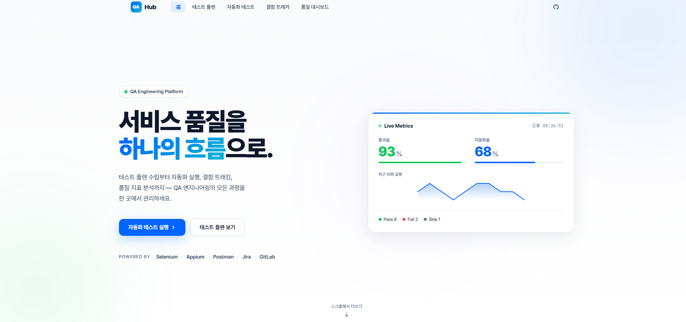

# QA Hub

> **서비스 품질을 하나의 흐름으로.**
> QA 엔지니어링의 전 과정 — 테스트 플랜 · 자동화 실행 · Jira × GitLab 교차 검증 · 품질 지표 — 을 하나의 콘솔에서 관리합니다.



### 🔗 [https://qa-dashboard-flax.vercel.app](https://qa-dashboard-flax.vercel.app)

[]()
[]()
[]()
[](https://qa-dashboard-flax.vercel.app)

---

## 🎯 왜 만들었나

실무에서 QA 업무는 보통 여러 도구에 분산되어 있어요.
테스트 플랜은 스프레드시트, 자동화는 별도 리포, 결함 추적은 Jira, 코드 변경은 GitLab, 품질 지표는 수동 집계.
**이 모든 흐름을 하나의 콘솔로 통합**하면 QA 엔지니어가 설계·실행·추적·분석에 집중할 수 있다는 가설에서 출발했습니다.

---

## ✨ 주요 기능

### 🚦 테스트 플랜
리스크 기반 TC 설계 · Smoke / Regression / Integration 카테고리 관리 · 담당자별 진행률 추적

### 🤖 자동화 테스트
PC · 모바일 · API · 부하 테스트 통합 실행
- **Selenium** (웹 브라우저) · **Appium** (Android / iOS)
- **Postman** (REST / GraphQL) · **JMeter / k6** (부하)
- Python · Java · JavaScript · TypeScript 멀티 언어 스크립트
- 실행 결과 자동 집계 + 통과율 추이

### 🔀 결함 트래커 — Jira × GitLab 교차 검증
릴리즈 범위 자동 매칭으로 배포 리스크 선제 탐지
- `fixVersion` 기준 Jira 티켓 수집
- `release/{version}` 브랜치 머지된 MR 수집
- MR 제목·브랜치·커밋에서 `[A-Z]+-\d+` 패턴으로 Jira 키 추출
- **매칭 / 누락 / 범위 외 / 상태 불일치** 4가지 자동 분류
- 담당자에게 Slack · 이메일 자동 알림 (액션 모달)

### 📊 품질 대시보드
릴리즈별 통과율 · 결함 밀도 · 자동화율 추이 시각화

---

## 🛠 기술 스택

| 영역 | 기술 |
|------|------|
| Frontend | Vue 3 (Options API) · Vite · Pretendard |
| Backend | Flask (Python 3.11) · psycopg2 |
| Database | PostgreSQL |
| 배포 | Vercel (Frontend) · Render (Backend) |
| 외부 연동 | Jira REST API · GitLab API · UptimeRobot |

---

## 📁 프로젝트 구조

```
qa-dashboard/
├── backend/
│   ├── app.py              # Flask API + PostgreSQL
│   └── requirements.txt
└── frontend/
    └── src/
        ├── App.vue
        ├── api/index.js
        └── components/
            ├── WBSList.vue             # 테스트 플랜 목록
            ├── WBSDetail.vue           # 테스트 플랜 상세
            ├── AutomationTest.vue      # 자동화 테스트 (PC·모바일·API·부하)
            ├── DefectCrossCheck.vue    # Jira × GitLab 교차 검증
            └── ...
```

---

## 🚀 로컬 실행

### 백엔드
```bash
cd backend
pip install -r requirements.txt
flask --app app run --port 5000
```

### 프론트엔드
```bash
cd frontend
npm install
npm run dev
```

브라우저에서 `http://localhost:5173` 접속.

---

## 📌 설계 노트

**🔐 데모 환경 안내**
공개 저장소 특성상 Jira / GitLab 토큰을 노출할 수 없어 **모의 데이터로 UI를 시연**합니다.
실제 API 호출 모듈은 설계되어 있으며, `.env`에 토큰만 세팅하면 실 데이터로 전환됩니다.

**📊 왜 자체 SVG 차트인가**
차트 라이브러리 의존성 없이 직접 SVG로 그렸습니다. 번들 크기 최소화 + 디자인 완전 제어가 목적이에요.

---

## 👤 Developer

**박수빈 (Subeen Park)**
QA Engineer @ SOOP (ex. Nexon Networks)
📬 mas_jaypark@naver.com · [@subeen-park](https://github.com/subeen-park)
